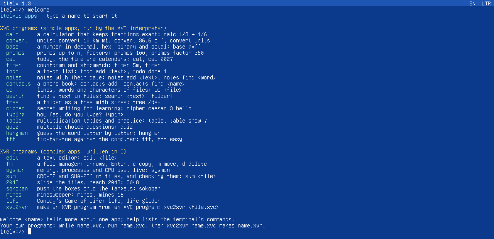
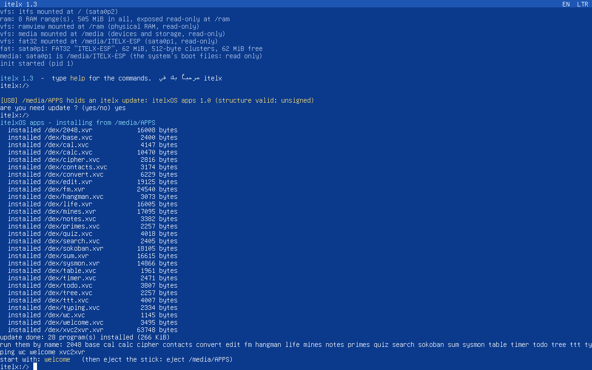
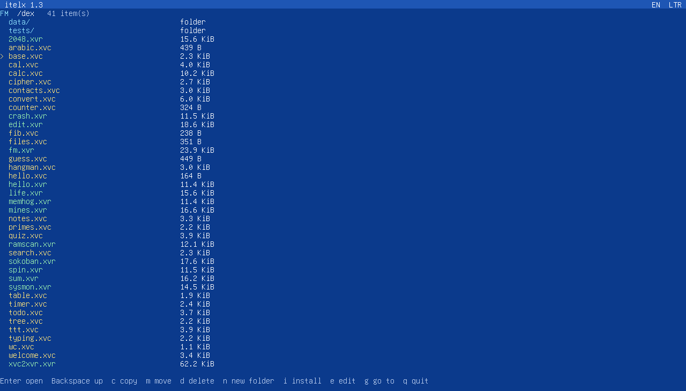
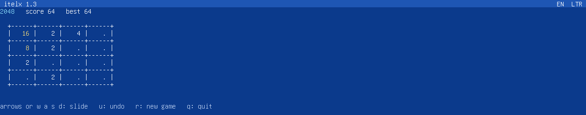
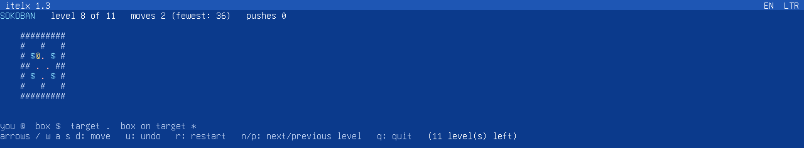
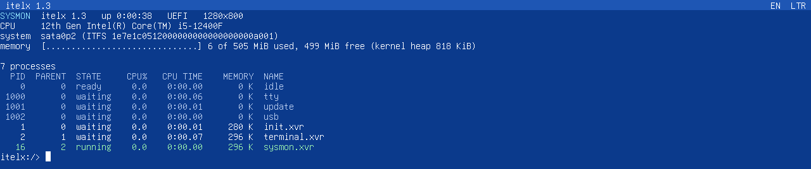
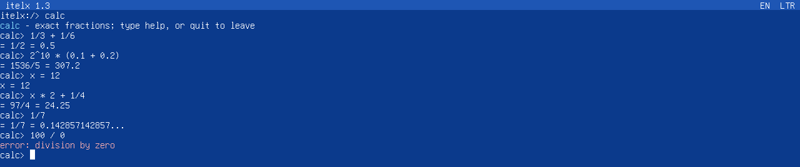
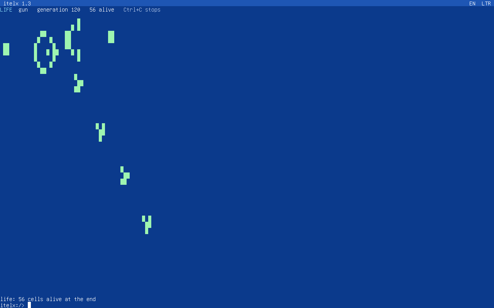
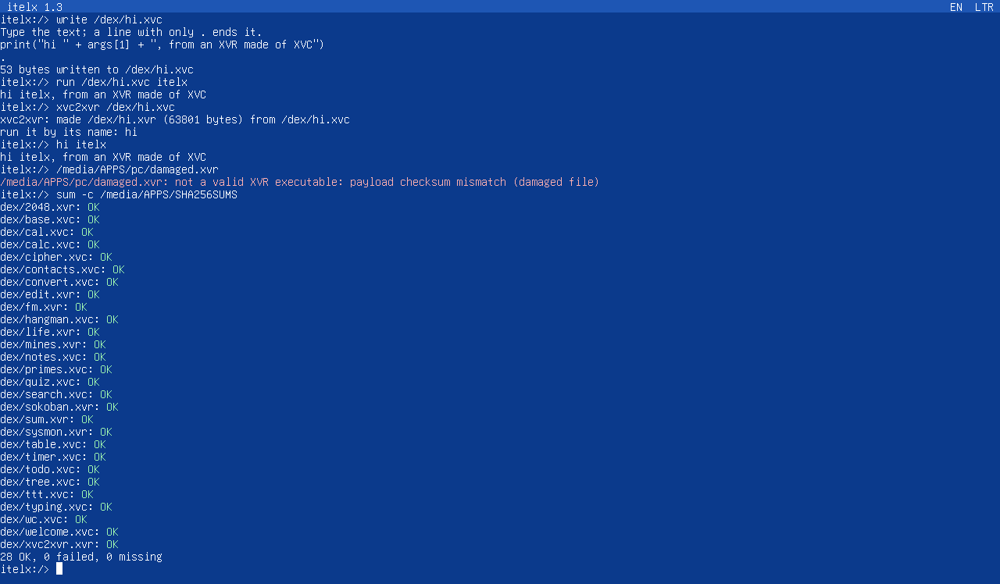

# itelxOS apps

Apps for **itelxOS**, the 64-bit operating system with its own kernel: simple
apps written in the **XVC** language and complex apps built as **XVR**
executables, a converter from XVC to XVR, the SDK to write your own, and a
guide in Arabic and English.

<p align="center"></p>

## بالعربي

مستودع تطبيقات لنظام **itelxOS**: تطبيقات بسيطة بلغة **XVC**، وتطبيقات معقدة
مبنية كملفات تنفيذية **XVR**، وأداة تحويل من XVC إلى XVR، والـ SDK لتكتب
تطبيقاتك أنت. الشرح الكامل بالعربي في [`docs/ar`](docs/ar/README.md):
ما هي لغة XVC، وكيف تكتب برنامجك الأول، وكيف تحوّله إلى XVR، وكيف تنقله إلى
النظام بفلاشة FAT32.

**للتثبيت بسرعة:** هيّئ فلاشة بنظام FAT32، وانسخ إليها محتويات المجلد
[`usb/`](usb)، ثم وصّلها بـ itelx وأجب بـ `yes` على السؤال
`are you need update ?`. بعدها اكتب `welcome`.

## Install them in one minute

1. Format a USB stick as **FAT32** (exFAT and NTFS are not read by itelx 1.3).
2. Copy **what is inside** [`usb/`](usb) to the top of the stick:
   `update.xvr` and the folder `dex/`.
3. Plug the stick into itelx and answer `yes` to `are you need update ?`.
4. Type `welcome`.

<p align="center"></p>

Details, also for Windows, Linux and macOS: [docs/en/5-usb-fat32.md](docs/en/5-usb-fat32.md).

## The apps

**Simple apps, in XVC** ([`apps/xvc`](apps/xvc)): read them, change them, learn from them.

| app | what it does |
|---|---|
| `welcome` | all the apps and how to start them |
| `calc` | a calculator with exact fractions: `1/3 + 1/6` is `1/2` |
| `convert` | units: length, mass, volume, time, data, speed, temperature |
| `base` | a number in decimal, hex, binary, octal (and as a character) |
| `primes` | primes up to n, factors, prime test |
| `cal` | today, the time, a month or a whole year |
| `timer` | countdown and stopwatch with laps |
| `todo` | a to-do list |
| `notes` | dated notes, with search |
| `contacts` | a phone book (Arabic names too) |
| `wc` | lines, words, characters and bytes of files |
| `search` | find a text in the files of a folder |
| `tree` | a folder as a tree, with sizes |
| `cipher` | Caesar (English and Arabic letters), ROT13, Vigenère |
| `typing` | typing speed and accuracy |
| `table` | multiplication tables and practice |
| `quiz` | multiple-choice questions |
| `hangman` | guess the word |
| `ttt` | tic-tac-toe against a computer that never loses |

**Complex apps, XVR executables written in C** ([`apps/xvr`](apps/xvr)):

| app | what it does |
|---|---|
| `fm` | a file manager: arrows, open, copy and move between disks and USB sticks, delete, install |
| `edit` | a text editor (lines, insert, replace, find, substitute, undo) |
| `sysmon` | memory, processes and their CPU use, refreshed every second |
| `sum` | SHA-256 and CRC-32 of files; checks `SHA256SUMS` lists |
| `2048` | the sliding tiles game, with undo and a best score |
| `sokoban` | 11 levels, each checked with a solver; undo, progress kept |
| `mines` | minesweeper, 9×9 to 30×20 |
| `life` | Conway's Game of Life, with patterns |
| `xvc2xvr` | makes an XVR executable from an XVC program, on itelx itself |

<p align="center">
 <br>
 <br>
 
</p>

## Learn

| | English | العربية |
|---|---|---|
| 1 | [The XVC language](docs/en/1-xvc-language.md) | [لغة XVC](docs/ar/1-xvc-language.md) |
| 2 | [Your first program](docs/en/2-first-program.md) | [برنامجك الأول](docs/ar/2-first-program.md) |
| 3 | [From XVC to XVR](docs/en/3-xvc-to-xvr.md) | [من XVC إلى XVR](docs/ar/3-xvc-to-xvr.md) |
| 4 | [XVR apps in C](docs/en/4-xvr-in-c.md) | [تطبيقات XVR بلغة C](docs/ar/4-xvr-in-c.md) |
| 5 | [USB sticks and FAT32](docs/en/5-usb-fat32.md) | [النقل بالفلاشة FAT32](docs/ar/5-usb-fat32.md) |

## XVC to XVR

```
itelx:/> xvc2xvr /dex/myapp.xvc            # on itelx
python tools/xvc2xvr.py myapp.xvc          # on a PC (Windows, Linux, macOS; Python 3)
python tools/xvrinfo.py myapp.xvr          # check a file as the kernel does, see what is inside
```

The XVR made from an XVC program is the XVC interpreter with the program
inside it: one file that installs and runs by its name, checked by the
kernel before it runs ([chapter 3](docs/en/3-xvc-to-xvr.md)).

<p align="center"></p>

## Building

Everything needed is in [`usb/`](usb) already built. To build it again, or
your own apps (Linux or WSL with `gcc`, `ld`, `make`, `python3`; a path
without spaces):

```bash
make              # sdk, apps, the USB kit -> usb/
make host-xvc     # build/host/xvc: XVC on the PC, to try programs
make check        # tests of the PC tools
```

`tests/e2e_itelx.py` starts a real itelxOS 1.3 in QEMU, plugs in a FAT32
stick made from `usb/`, accepts the update and then runs every app with
keys typed on the keyboard (43 checks, UEFI and BIOS).

## Layout

```
apps/xvc/        the simple apps (XVC)
apps/xvr/        the complex apps (C -> XVR); apps/lib: their screen and key helpers
kit/             update.xvr of the USB kit
sdk/             libitx, the system call interface, the XVR format, xvrlink, the XVC
                 interpreter, and xvcapp (the runtime of XVRs made from XVC)
tools/           xvc2xvr.py, xvrinfo.py, host-xvc (XVC on a PC)
usb/             ready for a FAT32 stick
docs/ar, docs/en the guide (Arabic, English)
screenshots/     the apps on itelxOS 1.3
tests/           tests of the tools, and the test on a real itelx
```

## Licence

[Mozilla Public License 2.0](LICENSE). The files in `sdk/` (but `sdk/xvcapp`)
and `tests/qemu.py` come unchanged from the itelxOS userspace, which is under
the same licence; `sdk/xvcapp`, the apps, the kit and the tools are new here. Programs you write for itelxOS with this SDK may be under any licence.
The itelx kernel itself is not part of this repository.

Copyright (c) 2026 Ahmed Walid (AXV).
