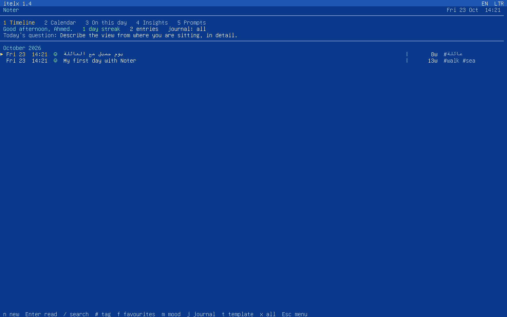
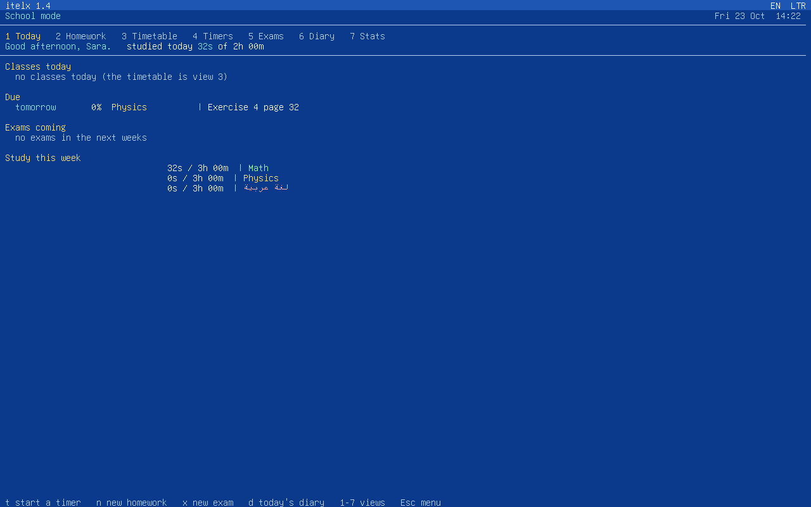
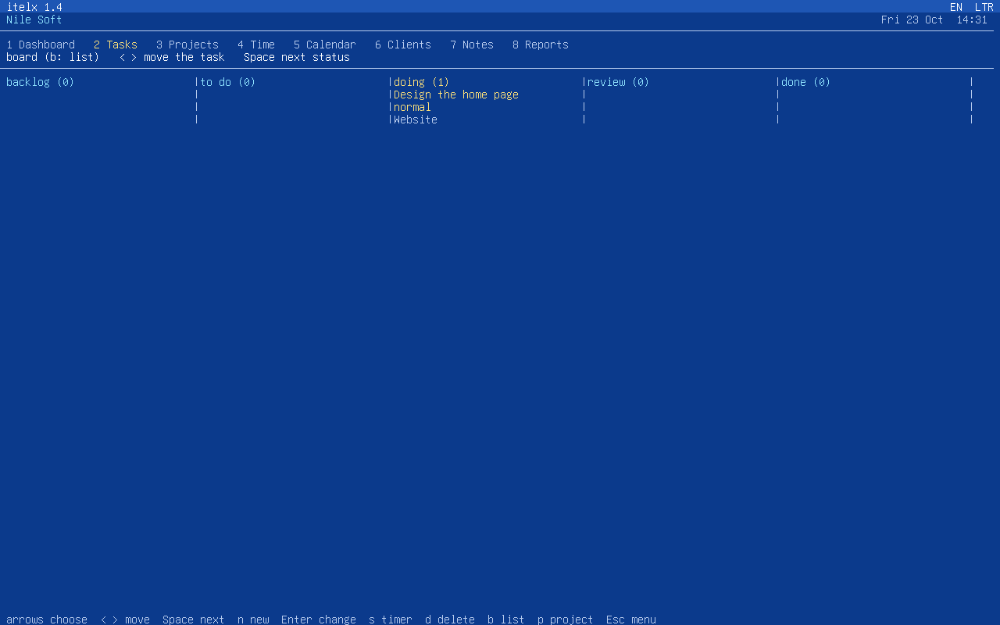
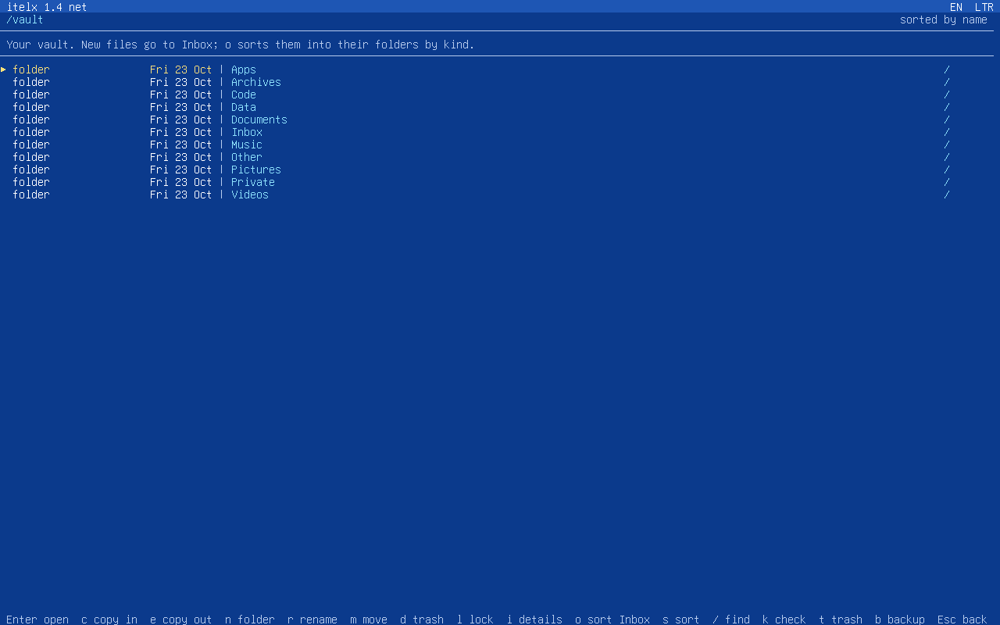
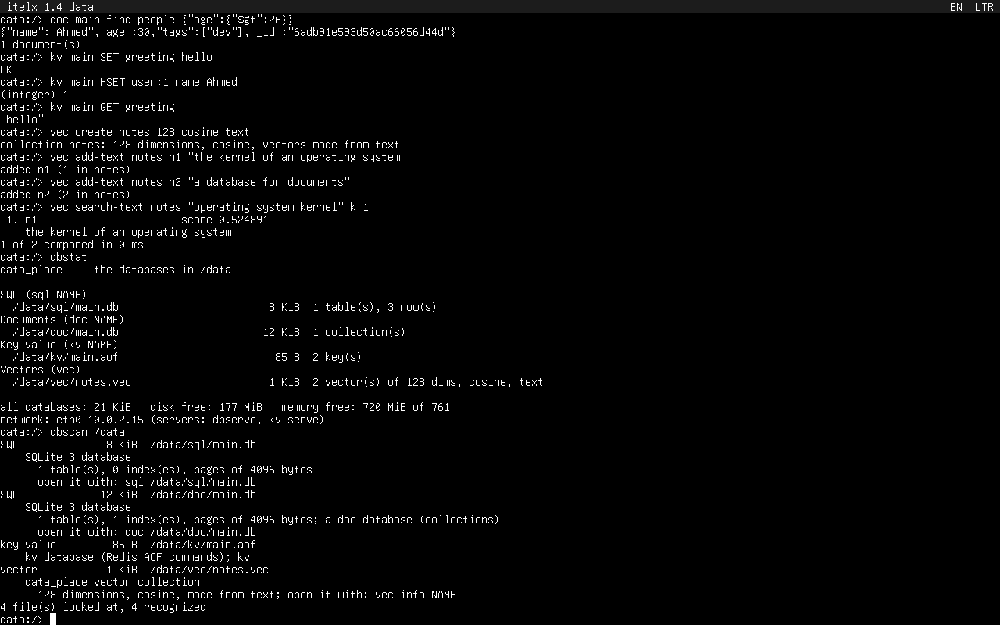

# 6. Customizer apps

[← Contents](README.md) · [Arabic](../ar/6-customizers.md)

A **customizer app** is one `.xvr` file that turns itelx into a system for
one job. Everything it installs is inside it: the program that comes up
instead of the terminal, the tools that go with it and, for two of them, an
itelx kernel with more drivers. One customizer is installed at a time, and
**recustomize** puts itelx back as it was right after it was installed.

| customizer | itelx becomes | comes up instead of the terminal | kernel |
|---|---|---|---|
| `noter` | a journal | Noter, full screen | itelx 1.4 |
| `school_mode` | a student's desk | School mode, full screen | itelx 1.4 |
| `work_mode` | a workplace | Work mode, full screen | itelx 1.4 |
| `file_saver` | a vault for files of any kind | its own terminal (`vault:/>`) | itelx 1.4 net: Ethernet |
| `data_place` | a data centre: SQL, documents, key-value, vectors | its own terminal (`data:/>`), black screen, white text | itelx 1.4 data: Ethernet |
| `recustomize` | itelx as installed | the itelx terminal | the original |

They are in [`customizers/release`](../../customizers/release). Each one
comes in two versions:

- `NAME.xvr` installs it.
- `NAME.txt` is for reading only: what it is, every file it puts on itelx
  with its size and SHA-256, and the source code of its installer.

The source of everything is in [`customizers/`](../../customizers): the
apps, the installer, the kernel changes, and the tools that pack them.
Customizers need **itelxOS 1.4**: on another version they say so and change
nothing.

## 1. Install one

Copy the `.xvr` to a FAT32 USB stick ([chapter 5](5-usb-fat32.md)) and plug
the stick into itelx. In the examples it is `/media/CZ`.

### Noter, School mode, Work mode

```
itelx:/> /media/CZ/noter.xvr
```

The installer shows what it is and every file it will write, then asks
`Install it? (yes/no)`. Answer `yes`. When it is done it asks
`Start it now? (yes/no)`; from then on itelx starts the customizer's
program instead of the terminal, after every restart too.

Two other ways do the same: `install /media/CZ/noter.xvr` and then `noter`,
or the file copied to the top of the stick as `update.xvr` (itelx asks
`are you need update ?` when the stick is plugged in).

### File saver and data_place: they bring a kernel

The kernel lives on the system's boot partition, and itelx 1.4 lets a
program write there only during an update that you accepted from a USB
stick. So these two install from the stick:

1. Run it from the terminal: `/media/CZ/file_saver.xvr`. It says that it
   brings its own kernel, copies itself to the stick as `update.xvr` and
   tells you what to do next. An `update.xvr` that was already on the stick
   is kept aside and comes back afterwards.
2. `eject /media/CZ`, unplug the stick and plug it in again. itelx asks
   `are you need update ?`: answer `yes`, then `yes` to `Install it?`.
3. It writes the files and the kernel, cleans the stick, and asks
   `Restart now? (yes/no)`. The new kernel starts with the next start.

### What the installer checks

- Every file inside it is checked (CRC-32) before anything is written.
- Each file is written as `NAME.new`, read back, compared, and only then
  renamed over the old one. A power cut leaves the old file or the new one,
  never half of one.
- It needs twice the size of its files free on the system disk.
- What is installed is written in `/system/customizer.txt`. Another
  customizer refuses to install while one is there (run `recustomize`
  first); the same one installed again repairs itself.

## 2. Back to itelx as installed: recustomize

Every customizer installs `/system/recustomize.xvr`. Run it:

- in Noter, School mode or Work mode: **Esc**, *System*, *Restore the system*;
- in File saver or data_place: type `recustomize`;
- or from a stick: `recustomize.xvr` from `customizers/release`.

It lists what it will do and asks you to type `YES` (in capitals). Then:

- the system files that are not the original ones are put back. It carries
  the files of itelx 1.4 inside it, taken from the 1.4 installer, so it
  works even when they were changed or deleted;
- the original kernel is put back. If the kernel is not the original one,
  this goes through the stick as in the install above;
- **every file and folder the original system does not have is deleted for
  good**: whatever was written with the customizer, and whatever was
  written before it;
- `/boot/cmdline`, `/system/hostname` and `/system/owner` stay: they were
  written for this computer when itelx was installed.

Back up first: `backup` in File saver, `dbbackup` in data_place, *Export*
in Noter's menu.

## 3. Noter

<p align="center"></p>

A journal. Its views (keys 1 to 5, Tab for the next one):

- **Timeline**: your entries by month, each with its mood, word count and
  tags. Today's question is shown above them.
- **Calendar**: the days you wrote on.
- **On this day**: what you wrote a week, a month and years ago.
- **Insights**: streaks, moods, tags and words.
- **Prompts**: questions to write about.

Each entry has a mood, `#tags`, a journal and can be a favourite. Templates
start an entry for you: daily reflection, gratitude, evening review and
others. `/` searches. A passcode can lock Noter, and the menu exports the
journal to a USB stick. Arabic and English both work; Alt+Shift switches
the keyboard. The data is in `/home/noter`.

## 4. School mode

<p align="center"></p>

A student's desk, with seven views (keys 1 to 7):

| view | what is in it |
|---|---|
| Today | today's classes, homework that is due, coming exams, time studied this week |
| Homework | due day, priority and progress; Space marks it done |
| Timetable | the classes of every day of the week |
| Timers | a study timer for each subject: its own length, Pomodoro, or a stopwatch |
| Exams | countdowns and topics |
| Diary | a page for every school day |
| Stats | time studied per subject against its weekly goal, the last eight weeks, grades |

The menu (Esc) also opens the tools: calculator, unit converter,
multiplication tables, typing practice and quiz (XVC apps of this
repository, installed into `/dex`). The data is in `/home/school`.

## 5. Work mode

<p align="center"></p>

A workplace for a freelancer or a small team, with eight views:

| view | what is in it |
|---|---|
| Dashboard | today's meetings, what is due, the week's hours, projects late or over budget, deals, unpaid invoices |
| Tasks | a list or a board (backlog, to do, doing, review, done); priorities, due days, estimates, checklists, tasks waiting for someone |
| Projects | status, client, deadline, budget in hours, hourly rate, progress |
| Time | a timer on a task or project that keeps running across restarts; the week's timesheet, billable or not |
| Calendar | meetings with agendas and minutes; their action items become tasks |
| Clients | people and companies, the deals pipeline |
| Notes | documents, by project |
| Reports | hours, money and tasks for a week, a month or a year |

From the menu: **invoices** made from a client's billable time, and
**expenses**. The tools: calculator, converter, `fm`, `edit`, `sum`. The
data is in `/home/work`.

## 6. File saver

<p align="center"></p>

Files of every kind are kept in `/vault`, sorted into folders by kind:
Documents, Pictures, Music, Videos, Archives, Apps, Code, Data, Private
and Other. New files land in Inbox.

- Every file is indexed with its SHA-256. `check` finds any file that
  changed or went missing.
- A file that is replaced keeps its earlier version.
- Deleted files go to the trash first.
- Files can be **locked** with the vault password. The encryption is
  ChaCha20 with HMAC-SHA-256, and the key comes from the password through
  PBKDF2. A forgotten password cannot be recovered, and neither can the
  locked files.

Its terminal has every itelx command and these:

| command | what it does |
|---|---|
| `vault` | the organizer, full screen: open, copy in and out, move, rename, lock, find, check, trash, backup |
| `store PATH [FOLDER]` | a file or a folder into the vault, sorted by kind |
| `organize` | the Inbox into the folders |
| `find TEXT` | files of the vault with TEXT in the name |
| `space` | what each folder takes |
| `check`, `reindex` | compare every file with its SHA-256; make a new index |
| `password` | set or change the vault password |
| `lock PATH`, `unlock PATH` | encrypt a file (or a folder's files), decrypt it |
| `trash [PATH]` | move to the trash, or list it; `trash restore NAME`, `trash empty` |
| `versions FILE` | the earlier versions of a file |
| `backup [STICK]`, `restore [STICK]` | the vault to a USB stick (only what changed), and back |
| `share [FOLDER] [PORT]` | a folder to the network, read only: a browser on another computer opens `http://ADDRESS:PORT/` |

and the network commands of [section 8](#8-the-network).

## 7. data_place

<p align="center"></p>

Databases of four kinds, on a black screen with white text. Their files are
in `/data`.

| tool | what it is |
|---|---|
| `sql` | SQL databases: **SQLite 3.54.1** with transactions, indexes, JSON, full-text search (FTS5), math and window functions; CSV import and export |
| `doc` | document databases in the manner of MongoDB: JSON documents, filters (`$gt`, `$in`, `$or` ...), updates (`$set`, `$inc`, `$push` ...) |
| `kv` | key-value databases in the manner of Redis: strings, counters, hashes, lists, sets, expiry; `kv serve` speaks the Redis protocol |
| `vec` | vector collections for AI: nearest-neighbour search by cosine, L2 or dot product, metadata filters, and text collections |
| `dbscan` | what a data file is, by what is inside it: about 40 kinds of databases and AI files |
| `dbstat` | every database at a glance |
| `dbserve` | all of them as an HTTP API with JSON, behind a token |
| `dbbackup`, `dbrestore` | `/data` to a USB stick and back, every file checked by SHA-256 |

SQLite is the real SQLite, built for itelx (public domain, from
sqlite.org). kv, doc and vec were written for data_place: doc stores its
documents in SQLite, kv keeps an append-only log, and vec keeps its own
files.

```
data:/> sql main "create table city (name text, people int)"
data:/> sql main "insert into city values ('Cairo', 10000000), ('Aswan', 1500000)"
data:/> sql main "select name from city where people > 2000000"
data:/> sql main                            the SQL shell: .help, .tables, .mode, .import ...

data:/> doc main insert people {"name":"Mona","age":25}
data:/> doc main find people {"age":{"$gt":20}}

data:/> kv main SET greeting hello
data:/> kv main HSET user:1 name Ahmed

data:/> vec create notes 128 cosine text
data:/> vec add-text notes n1 "the kernel of an operating system"
data:/> vec search-text notes "operating system kernel" k 1
```

Each tool started without a command opens its own shell, which lists its
commands: `.help` in sql, `help` in doc and vec, `HELP` in kv.

**From another computer.** In both cases the PC must reach itelx's
address (`net`).

- `kv serve main 6379 PASSWORD &` serves a key-value database in the Redis
  protocol, so `redis-cli -h ADDRESS -a PASSWORD` and Redis client
  libraries can connect. Without a password, one is made and shown.
- `dbserve 8086 TOKEN &` serves everything as JSON:

```bash
curl -H "Authorization: Bearer TOKEN" http://ADDRESS:8086/
curl -H "Authorization: Bearer TOKEN" -d "SELECT * FROM city" http://ADDRESS:8086/sql/main
curl -H "Authorization: Bearer TOKEN" -d '{"filter": {"name": "Mona"}}' http://ADDRESS:8086/doc/main/people/find
curl -H "Authorization: Bearer TOKEN" -d '["GET", "greeting"]' http://ADDRESS:8086/kv/main
curl -H "Authorization: Bearer TOKEN" -d '{"text": "a kernel", "k": 3}' http://ADDRESS:8086/vec/notes/search
```

A request without the token gets `401`. dbserve answers one request at a
time. Both use plain HTTP and TCP without encryption, so use them on a
network you trust.

**Text vectors.** A text collection turns words into vectors on itelx
itself. It uses feature hashing (Arabic without its marks, and the forms of
alef, ta marbuta and alef maqsura made one), so `search-text` finds texts that share words, not texts that share
meaning. For search by meaning, make the vectors with an AI model on a PC
and import them: `vec import NAME FILE` takes `.csv` or `.jsonl`.

## 8. The network

File saver and data_place bring an itelx kernel with Ethernet:

| card | driver |
|---|---|
| Intel PRO/1000: 82540EM, 82545EM, 82544GC | e1000 |
| Intel 82574L | e1000e |
| Realtek RTL8139 | rtl8139 |
| virtio-net (virtual machines) | virtio-net |

The address comes from DHCP as soon as the cable is plugged in. The kernel
has IPv4 with ARP, ICMP, UDP, DNS and TCP. These commands are in both
terminals:

| command | what it does |
|---|---|
| `net` | the cards, the address, the router, DNS |
| `net dhcp` | ask DHCP for an address again |
| `net static IP/BITS ROUTER DNS` | set the address by hand |
| `ping HOST [N]` | does a computer answer, and how fast |
| `dns NAME` | the address of a name |
| `fetch URL [FILE]` | download a file over `http://` |

**What it does not have:**

- **WiFi.** WiFi chips need their maker's firmware, and a WiFi driver
  cannot be tested in a virtual machine, so none is included rather than
  one that was never seen working.
- Cards not in the table, such as Realtek 8111/8168 or Intel I219.
- IPv6.
- `https://`.

`net` says when no card has a driver.

## 9. Build them

On Linux or WSL, with what [chapter 4](4-xvr-in-c.md) needs:

```bash
make customizers
```

This builds every customizer and recustomize into `customizers/release`
(`.xvr`, `.txt` and `SHA256SUMS`). What a customizer installs is listed in
`customizers/NAME/payload.txt`; its programs are the folders in
`customizers/NAME/apps`.

The two kernels are in `customizers/kernel/out`. They are built from the
itelx 1.4 source by adding the network files of
`customizers/kernel/src` and applying `customizers/kernel/itelx-1.4-net.patch`:

```bash
bash customizers/kernel/build-kernel.sh /path/to/itelxOS64bit
```

`tests/e2e_customizers.py` tests them all on a real itelxOS 1.4 in QEMU.
For each customizer it installs it, uses it with keys typed on the
keyboard, and restores the system with recustomize. It also tests the
network with every card in the table above: DHCP, ping, and a 3 MiB
download whose SHA-256 must match the PC's copy.
